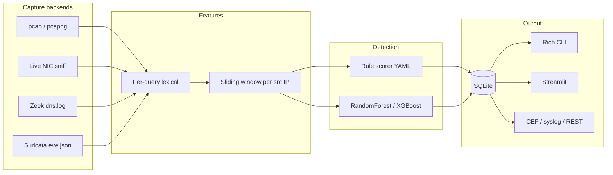

# DNS Exfil Detect

Defensive sensor for **DNS tunneling used as exfiltration or command-and-control** after an attacker already has a foothold. It sits in the later stages of the cyber kill chain (actions on objectives / C2), not initial access: the host is already inside the network and is trying to hide data or callbacks in DNS queries that recursive resolvers will forward.

This project does **not** implement a tunnel client, encoder, or C2 protocol. It only parses DNS telemetry and scores it.

## How DNS tunneling shows up in the kill chain

1. **Foothold already exists** (phishing, vuln, stolen creds).
2. **Egress is restricted**, but DNS to an internal resolver is usually allowed.
3. The implant encodes bytes in **subdomain labels** (or abuse TXT/NULL records) and queries a domain the attacker controls.
4. The recursive resolver forwards the query to the authoritative server the attacker operates; replies can carry C2 instructions.

Typical observable artifacts (what this tool scores):

- unusually **long labels** and FQDNs
- **high Shannon entropy** and base32/64-like character mixes
- **many unique subdomains** under one unpopular parent (chunked uploads)
- elevated **NXDOMAIN** ratios and **TXT/NULL** spikes
- query rates that do not look like a browser or OS update

## Architecture



Layout:

| Package | Role |
| --- | --- |
| `capture/` | Swappable backends (`CaptureBackend`) |
| `features/` | Query + window feature extraction |
| `detection/` | Rule weights + ML classifier |
| `storage/` | SQLite schema + SIEM formatters |
| `cli/` | Typer entrypoint |
| `dashboard/` | Streamlit UI |

Pure Python, `pathlib` only, no OS-specific syscalls. Live capture uses **scapy’s** portable sniff API (Npcap on Windows, libpcap on Linux/macOS).

## Detection methodology

### Per-query features

Source IP, FQDN, timestamp, record type (A, AAAA, TXT, NULL, CNAME, …), longest label length, FQDN length, Shannon entropy of subdomain labels, letter/digit/hyphen/other ratios, encoding-likeness heuristic, character n-gram log-likelihood vs a legitimate-domain corpus, NXDOMAIN flag, Tranco-style popularity hit.

### Window features (per source IP)

Configurable sliding window (`window.size_seconds` / `slide_seconds` in YAML):

- query count and queries-per-minute
- unique FQDNs and unique-subdomain ratio per parent (chunking signal)
- NXDOMAIN ratio, TXT/NULL fraction, response size stats
- mean/max entropy and label length
- fraction of queries whose parent is **not** on the local top-list

Windows are emitted on a slide cadence and flushed at end-of-stream so the same code path works for files and a live feed.

### Dual engine

1. **Rules** — each signal is a 0–1 ramp against YAML thresholds, multiplied by YAML weights, summed. The top contributions are stored as `reason` (explainable).
2. **ML** — RandomForest (default) or XGBoost on the same window vector. Probability is stored next to the rule score.

A window alerts if **either** engine exceeds its threshold (when both are enabled).

## Data labeling (ML)

| Label | Meaning | How it is produced |
| --- | --- | --- |
| `0` | Benign recursive DNS | Popular hostnames, A/AAAA, low NXDOMAIN, repeated names |
| `1` | Tunnel-**shaped** traffic | Unique high-entropy labels, TXT/NULL mix, NXDOMAIN spikes, unpopular parent |

**Train/test split is by capture session**, not a random shuffle of rows from one pcap:

- train: session 0 (benign) + session 1 (tunnel-shaped)
- test: session 2 + session 3 (different IPs, time bases, parent domains)

Random intra-pcap splits leak the same implant’s naming pattern into both sets and overstate accuracy. Retrain on **your** pcaps the same way: one day’s campus DNS vs a later day, or two independent lab captures.

For operational use, label windows (or whole source IPs) from known-good resolver logs and from confirmed tunnel incidents / lab tools you already run in a range. Point `benchmark.py` at those two pcaps.

## Install

Python 3.10+.

```bash
python -m venv .venv
# Windows: .venv\Scripts\activate
# Linux/macOS: source .venv/bin/activate
pip install -e ".[dev]"
```

Live sniffing additionally needs Npcap (Windows) or libpcap (Linux/macOS) and usually elevated privileges.

Drop a full [Tranco](https://tranco-list.eu) CSV on `data/tranco_sample.txt` (or set `reputation.tranco_path`) for production reputation checks. The repo ships a small sample plus an n-gram corpus in `data/legitimate_domains.txt`.

## CLI

```bash
# Offline pcap or Zeek/Suricata logs
dns-exfil-detect analyze --pcap capture.pcap
dns-exfil-detect analyze --path dns.log
dns-exfil-detect analyze --path eve.json --siem

# Live (port 53 via BPF)
dns-exfil-detect analyze --iface eth0 --timeout 30 --count 500

# Train (session split) + feature importance
dns-exfil-detect train --backend random_forest

# Labeled pcaps: TPR/FPR/precision/recall/F1 + confusion matrix
python benchmark.py --generate-demo
dns-exfil-detect benchmark --benign data/demo/benign_session.pcap --malicious data/demo/tunnel_session.pcap

# Threshold sweep (window-level F1)
dns-exfil-detect sweep

# Dashboard + JSON API
dns-exfil-detect dashboard
dns-exfil-detect serve-api --port 8080
dns-exfil-detect export-siem --format cef
```

Config: `config/default.yaml` (copy and pass `--config`).

## Storage and SIEM

SQLite (`data/detections.db` by default):

- `raw_queries` — timestamp, src_ip, fqdn, record_type, response_code, plus extracted fields
- `detections` — timestamp, src_ip, domain, rule_score, ml_score, reason, raw_query_count, risk_level, window bounds

Export CEF or syslog, or `GET /detections` and `GET /queries` on the REST API. Schema is intentionally flat for SIEM ingest.

## Tests

```bash
pytest
```

Coverage includes Shannon entropy and encoding heuristics with known inputs, Zeek/Suricata parsers, SQLite/CEF, rule separation of synthetic sessions, demo-pcap benchmark (rule engine first), threshold sweep, and ML session-split F1.

## Measured results (bundled demo sessions)

These numbers are from the **synthetic demo pcaps** generated by `write_demo_pcaps` / `python benchmark.py --generate-demo` (not a claim about every real malware family). Re-run after changing YAML thresholds.

| Engine | Session-level | Precision | Recall | F1 | Confusion `[[TN, FP], [FN, TP]]` |
| --- | --- | --- | --- | --- | --- |
| Rules | one benign pcap vs one tunnel-shaped pcap | 1.00 | 1.00 | 1.00 | `[[1, 0], [0, 1]]` |
| ML (held-out sessions) | window-level test set | ≥ 0.90 in CI | ≥ 0.90 | ≥ 0.90 | see `dns-exfil-detect train` JSON |

Rule F1 across thresholds is printed by `dns-exfil-detect sweep`. On the synthetic window set, F1 stays high for thresholds in roughly **0.40–0.70**; the default `alert_threshold` is **0.55**.

**Limitations:** CDNs, DNS-SD, security products, and newly registered SaaS domains can look “unpopular.” Tune weights, raise `min_queries`, and load a full Tranco list plus an org allow-list corpus before using as a blocking control. Prefer alert → analyst review.

## Deployment notes

| Environment | How to run |
| --- | --- |
| Analyst workstation | `analyze --pcap` / Zeek `dns.log` exported from the SIEM |
| Monitoring VM | cron/systemd: rotate pcaps or tail Suricata `eve.json`; SQLite on a data volume |
| SPAN/TAP sensor | `analyze --iface <span>` with Npcap/libpcap; optionally ship CEF to the SIEM |

Keep the process **read-only** on the wire. Do not terminate DNS; this is a detector.

Swap capture backends by implementing `CaptureBackend.events()` (for example a Kafka consumer of Zeek JSON). Feature extraction and scoring stay unchanged.

## License

Apache-2.0
